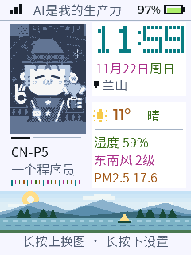
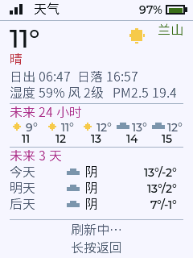

<div align="center">

# My Passport OS

**Third-party firmware for FoloToy AI Passport · ESP32-C3 · 8 MB Flash · 240×320**

Built on top of [FoloToy AI Passport OS](https://github.com/manchunx7-bit/passport-os)
UI and graphics inspired by the community firmware **1944 "Pocket Treasure Box"**

[简体中文](../README.md) · **English**

</div>

---

## What this is

A personal fork of Passport OS for a small ESP32-C3 device (8 MB flash, no PSRAM, 240×320 ST7789 display).

Changes on top of upstream: light/dark appearance switching, a Weather app, redrawn home-screen artwork and portrait rendering, LAN-direct phone setup, coloured launcher icons, plus the upstream rc.59 voice-control work (Xiaozhi MCP device tools, double-click to talk, face animation) and its new apps.

> This is a personal branch. It does not aim to replace upstream and makes no stability promises — follow the upstream repository for the mainline.
## Screenshots

Captured on the device (240×320, light appearance) through the firmware's serial screenshot command `p`:

| Home | Weather |
| --- | --- |
|  |  |

| City radio | App drawer |
| --- | --- |
|  |  |


## Code source and licence

This repository is a **derivative work** of [FoloToy AI Passport OS](https://github.com/manchunx7-bit/passport-os), released under the **MIT** licence.

| | |
| --- | --- |
| Upstream | <https://github.com/manchunx7-bit/passport-os> |
| Branch point | `b70879b` (`v0.1.0-8`) |
| Upstream version merged | `5101891` — Passport OS 0.2.0-rc.59 |
| Version here | `0.2.0-rc.61` |
| Licence | MIT, original copyright notice kept in [`LICENSE`](../LICENSE) |

Upstream copyright belongs to **FoloToy** (`Copyright (c) 2026 FoloToy`) and its contributors. This fork keeps the original notice and is released under the same MIT terms; keep the `LICENSE` file intact when redistributing.

## UI and graphics reference

Layout, colour and icon language reference the community firmware **1944 "Pocket Treasure Box"**, another community build for the same hardware.

- 1944 has **no public source code**; no code, font or binary asset from it is copied here.
- The reference was taken from the device's own screens, and every drawing routine here was **written independently** (LVGL rectangles / pixel shapes / palettes).
- Home-screen artwork, launcher icons and portrait presets are self-drawn in the same visual style:
  - `tools/gen_band_art.py` — artwork generator and preview (16-colour I4)
  - `tools/gen_launcher_icon_preview.py` — launcher icon preview
- If the 1944 author has any concern, please open an issue and it will be adjusted immediately.

## What changed compared to upstream

- **Light / dark appearance**: light, dark, or follow sunrise/sunset; 4 themes × 2 appearances.
- **Coloured launcher icons**, one palette per app, including the newly added apps.
- **Six portrait presets**: dots, flat, flat + local dots, comic line art, silhouette, halftone print.
- **Two home artwork scenes** (city night / mountain lake), packed as 16-colour I4, auto-dimmed in dark mode.
- **Configurable brand text** on the home screen.
- **Weather app** plus a **system-level refresh service**: weather every 15 min, air quality every 30 min, retry after 2 min on failure, city changes refresh immediately; it steps aside while audio apps are in the foreground. Home and the Weather app only read the cache, so both open instantly.
- **Phone setup over LAN**: when the device is online the page shows the current SSID and IP, so the phone can open it from the same network instead of joining the setup hotspot.
- **Upstream rc.59 merged in**: Xiaozhi MCP device control, double-click the OK button to talk, face animation, and the NetEase Music, Reminders, Text Lists and AI Hotspot apps.
- **Removed**: two apps ("你在狗叫什么" and "随身 Muse"); their `APP_ID` values are kept so stored settings do not shift.

## Build

Requires **ESP-IDF 5.5.x** (verified on 5.5.3); LVGL 9.5 is pulled by the component manager.

```bash
idf.py set-target esp32c3
idf.py build
python tools/verify_firmware.py
```

Host-side tests (no hardware needed):

```bash
bash tools/test-host.sh
```

## Flash

Flashing only the app partition keeps NVS (settings, business card, Wi-Fi):

```bash
python -m esptool --chip esp32c3 -p COM5 -b 460800 \
  --before default_reset --after hard_reset \
  write_flash --flash_mode dio --flash_size 8MB --flash_freq 80m \
  0x10000 build/passport-os.bin
```
Or use `python tools/flash_app.py` (Windows): it backs up NVS and SPIFFS first — Wi-Fi credentials, settings, portraits — then writes the app partition, and can restore that backup with `--restore`.


More detail in [`docs/MAINTENANCE.md`](MAINTENANCE.md) and [`docs/remote-build.md`](remote-build.md).

## Related project

[**ai-passport-voice-assistant**](https://github.com/CN-P5/ai-passport-voice-assistant) — a voice-input assistant that turns this device into a PC microphone: talk to it and text lands on your computer, handy for long-form writing, dictation and chat without an extra mic.

## Licence

[MIT](../LICENSE). Original copyright FoloToy; modifications in this repository are released under the same licence.

## Credits

- [FoloToy Passport OS](https://github.com/manchunx7-bit/passport-os) — upstream firmware and hardware
- The 1944 "Pocket Treasure Box" author — visual reference
- [LVGL](https://lvgl.io/), [ESP-IDF](https://github.com/espressif/esp-idf) and all upstream dependencies
